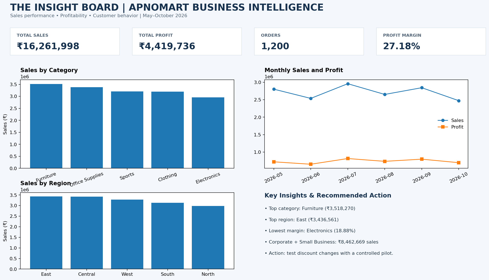

# The Insight Board — ApnoMart Business Intelligence Dashboard

## Project overview
Business intelligence analysis of 1,200 ApnoMart orders, covering sales, profit, categories, regions, customer segments, payment methods and monthly trends.

**Analysis period:** May–October 2026 (based on source dates).

## Dashboard screenshot

## Key metrics
- Orders: 1,200
- Total sales: ₹16,261,998.30
- Total profit: ₹4,419,736.17
- Overall profit margin: 27.18%

## Key insights
- **Revenue:** Furniture is the largest sales category at ₹3,518,270.00 (21.6%).
- **Profitability:** Electronics has the lowest category profit margin at 18.88%; Office Supplies has the highest at 34.80%.
- **Regional performance:** East has the highest sales at ₹3,436,561.15; Central has the highest profit at ₹943,677.84.
- **Customer behavior:** Corporate sales are ₹4,311,027.50; Small Business sales are ₹4,151,641.15.
- **Recommendation:** Run a controlled Electronics discount/margin pilot and test repeat-order offers for Corporate and Small Business customers.

## Files
- `dashboard_screenshot.png` — screenshot for submission.
- `insights_report.pdf` — completed executive insights report.
- `analysis_dashboard.xlsx` — Excel workbook with analysis sheets and charts.
- `apnomart_sales_data.csv` — input data.

## Submission steps
1. Create a GitHub repository named `the-insight-board-apnomart`.
2. Upload these four files and this README to the repository root.
3. Check that the screenshot appears in the README preview.
4. Submit the repository URL in the assignment portal.

## Method note
Overall profit margin is total profit divided by total sales. Results are descriptive; recommendations should be tested before rollout. The source dates cover May–October 2026, so the report does not describe this as strictly Q2.
